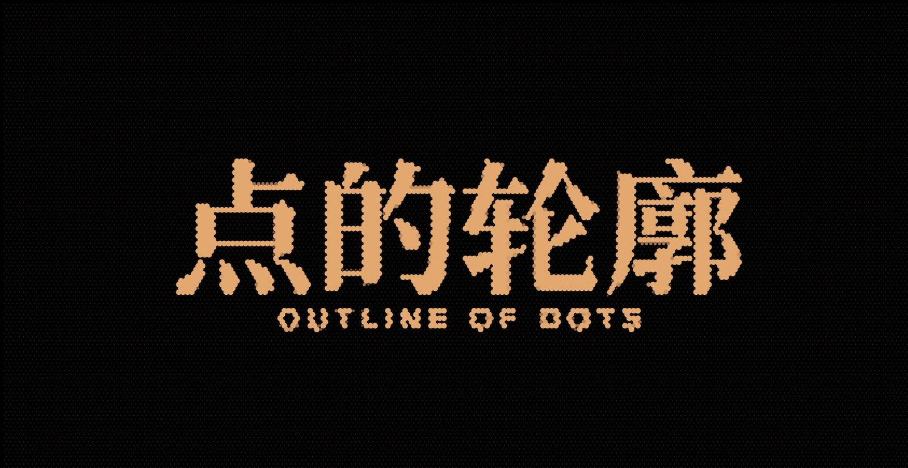

# O.motion 模板合集

把自制模板收拢到一个公开入口：一眼看清有哪些模板、能改什么、当前是什么状态、去哪里拿。

本仓库**只承载索引与文档**，不分发模板二进制、不含账号凭据、不含本机路径。模板本体通过 MotionGit 平台获取。



> 上图为点阵肖像成片的结尾标题帧（v1.0.0，标题「点的轮廓 / OUTLINE OF DOTS」）。人像帧涉及示例人物肖像，不在公开仓展示。

---

## 收录什么

1. 只收**自研 / 自制**的 `.motion` 模板（原创，或参照公开成片、可读契约后自主实现，不使用任何第三方模板资产）
2. 每条必须写明**当前状态**与**证据等级**，不用"应该能用"这类判断代替实测
3. **不收录**以下两类：第三方个人下载包（内含密钥，红线）；带第三方品牌标的包（永久不进合集）

### 来源性质四档

按「交付包里有没有他人的代码或素材」判定，而不是按"像不像"判定：

| 档 | 术语 | 定义 |
|---|---|---|
| 01 | 原创 | 参考对象为空，从零设计与实现 |
| 02 | 成片参照 | 只看公开成片的画面语言，元素、文案、程序全部自制 |
| 03 | 契约参照 | 参照对象给出可读契约（参数与结构说明），按契约复现 |
| 04 | 二次开发 | 复用他人代码或素材，须有授权 |

没有他人代码或素材的，无论参考了什么，都属于自主实现。

## 模板一览

| 模板 | 模板 id | 来源性质 | 画幅 | 时长 | 状态 | 许可 | 说明 |
|---|---|---|---|---|---|---|---|
| 点阵肖像（DotMatrix Portrait） | `dotmatrix-portrait-v1` | 成片参照 | 16:9 | 13 s（8–30 s 可调） | 已发布（MotionGit，[作品页](https://motiongit.com/@fangcs/dotmatrix-portrait-v1)，v1.5.0，下载 119） | MIT | [docs/dotmatrix-portrait.md](docs/dotmatrix-portrait.md) |
| 暗场极客知识口播 | `geek-dark-talk-v1` | 成片参照 | 16:9 | 4 min 29 s（默认样例，按时长伸缩） | 已发布（MotionGit，[作品页](https://motiongit.com/@fangcs/geek-dark-talk-v1)，v1.3.1，下载 21） | MIT | [docs/geek-dark-talk.md](docs/geek-dark-talk.md) |
| 3D粒子形变 | `particle-form-morph-v1` | 成片参照 | 16:9 | 18 s（默认，6–30 s 可调） | 已发布（MotionGit，[作品页](https://motiongit.com/@fangcs/particle-form-morph-v1)，v1.3.1，下载 4） | MIT | 八个三维粒子形状连续形变；原身份含旧来源词，已下架并以此新身份重发 |

## 暂未公开发布

以下为本项目自主实现、已完成本地验收但**暂不对外提供**的模板，仅作登记，不提供源码与预览：

| 模板 | 形态 | 来源性质 | 状态 | 备注 |
|---|---|---|---|---|
| 光带成字 | `.motion` / html-canvas | 契约参照 | 本地留存 | 还原度存在已知差距，见 [docs/light-ribbon-word.md](docs/light-ribbon-word.md) |
| 海边电影感·竖屏 | 目录型网页模板 v1.2 | 原创 | 本地留存 | 暂不公开 |
| 板书讲解·英语句式 | `.motion` / html-canvas | 成片参照 | 本地留存 | 暂不公开 |

## 状态口径

| 状态 | 含义 |
|---|---|
| `published` | 已在 MotionGit 通过审核并公开，可直接获取 |
| `in-review` | 已提交 MotionGit 审核，未通过前不对外承诺可用性 |
| `draft-private` | 本地与私有仓已完成验收，未提交公开平台 |
| `shelved` | 实测可跑但暂不对外提供（质量、定位或授权原因） |

> 版本可见性：平台上提交过的历史版本，**只有曾发布成功的版本对其他用户可见**；审核中或审核通过但未对外发布的版本仅作者自己能看到。因此作品页显示的版本号可能跳号（中间版本不对外）。

## 快速开始

- **在 MotionGit 使用**：在模板页安装后，按「可改参数」替换素材与文案，直接出片
- **本地渲染**：需要 Node.js 22+、Chromium（Playwright 管理）、FFmpeg / ffprobe；参数以各模板 `params.schema.json` 为准
- **参数与时间点**：详见各模板说明页与 [docs/usage.md](docs/usage.md)

## 仓库结构

```
.
├── README.md              本文件：合集入口、来源性质与状态口径
├── catalog.json           机器可读索引（与上方表格同源）
├── docs/
│   ├── assets/
│   │   └── preview-title.jpg     点阵肖像结尾标题帧（公开预览）
│   ├── dotmatrix-portrait.md    点阵肖像：参数表、时间轴、使用建议
│   ├── geek-dark-talk.md        暗场极客知识口播：参数表、角色映射、渲染命令
│   ├── light-ribbon-word.md     光带成字：契约还原范围与已知差距
│   ├── seaside-portrait.md      海边电影感·竖屏
│   ├── board-writing-english.md 板书讲解·英语句式
│   └── usage.md                 通用使用与渲染说明
├── CHANGELOG.md           合集变更记录
├── LICENSE                MIT（模板许可以各自 motion.json 为准）
└── .gitignore
```

## 许可与合规

- 仓库内文档与索引：**MIT**
- 各模板许可以该模板 `motion.json` / MotionGit 页面声明为准（点阵肖像为 MIT）
- 本仓库不含任何账号凭据、密钥、个人下载层包体与绝对路径

## 联系

- MotionGit：[@fangcs](https://motiongit.com/fangcs)
- 问题与建议：开 Issue
