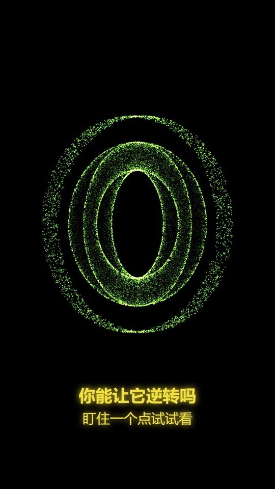

# 3D粒子_逆转乾坤（particle-arrow-illusion）

**一句话**：暗底上数万荧光粒子组成的图形匀速旋转，旋转方向两可——盯住是一个方向，视线一移它就「逆转」；改字换色即时出片，模板自带设计推荐。

| 项 | 值 |
|---|---|
| 编号 | `0110010001` |
| 模板 id | `0110010001-particle-arrow-illusion` |
| 版本 | v0.1.0 |
| 类型 | 完整模板（`full-template`），html-canvas |
| 画幅 / 帧率 | 1080×1920 / 30fps（9:16 竖屏） |
| 时长 | 固定 15 s（首尾帧完全相同，无缝循环） |
| 许可 | mg-commercial（成片可商用；模板本身不可再分发） |
| 获取 | MotionGit [作品页](https://motiongit.com/@fangcs/0110010001-particle-arrow-illusion) |

## 画面与节奏

暗底荧光粒子构成图形绕竖直轴匀速转三周，约 5 秒一圈；因无光照、无阴影、无景深，旋转方向完全两可（双稳态错觉）。底部一行暖黄发光大字＋一行小字全程常驻，不淡出。450 帧整片，首尾帧一致，循环播放毫无跳帧。

## 可改内容

- `title` 主标题：≤14 字，建议 8–12 字的挑衅句式（据说能让它反转的人 / 你能让它逆转吗）
- `subtitle` 副标题：≤16 字，可留空（智商堪比爱因斯坦 / 盯住一个点试试看）
- `color` 粒子颜色：RGB，默认荧光绿 `[124,255,58]`；亮色系错觉效果最佳，避免接近黑色的深色
- `shape` 图形：内置 `arrow`（逆转箭头，默认）与 `rings`（双环互扣）**两套预置方案**——它们只是起点，模板具备即时设计与推荐能力，按你的文案与配色重新生成画面并推荐合适的图形

## 适合 / 不适合

- 适合：互动挑战类短视频（评论区天然分两派）、科技感开场或循环垫片、需要「让人盯住看」的注意力钩子
- 不适合：需要明确叙事推进的片子（无镜头切换）；亮底/浅色背景（错觉依赖暗底与亮粒子的对比）

## 已知限制

- 15 秒与约 5 秒一圈的角速度是按错觉最佳效果定的，变速会破坏双稳态
- 无音轨：需要配乐或音效请自行叠加
- 图形切换为参数级切换，不支持导入自定义 3D 模型
- 版本只增不覆盖：后续改动走 1.0.1 patch
